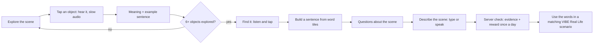

# PING VIBE: Contextual Vocabulary Experiences (Word Scenes)

1 November 2026 · Status: **8 scenes implemented and tested** (`/world/word-scenes`). Future scenes are listed at the end as recommendations.

Word Scenes teach words inside a place a child can explore, not through definitions alone.

- Each scene follows the same ten-step flow, adapted to the child's age band.
- Answers are checked on the server.
- Exploring never adds to the child's five new words a day.
- Results feed vocabulary, grammar and usage evidence, the passport and recommendations.

## 1. Learning flow (implemented)

| Step | What the child does | What PING VIBE records |
|---|---|---|
| 1. Explore | Taps objects in an original illustrated scene; hears the word (🔊) and a slow version (🐢) | Explored words (need 6+) |
| 2. Understand | Reads a child-friendly meaning and an example sentence, which can be heard aloud | — |
| 3. Find it | Hears "Find the …" and taps the right object (4 rounds; a wrong tap says what it was) | Listening practice (not scored) |
| 4. Build a sentence | Orders word tiles; valid alternative orders are accepted | `grammar_sentences` evidence |
| 5. Questions | Answers 2 scene questions (age-levelled) | `meaning` evidence (vocabulary) |
| 6. Describe | Types or optionally speaks a description; the server counts the scene words used; personal information is screened | `usage` evidence |
| 7. Feedback | Score, the right answer for any miss, and the scene words the child used | XP + VIBE COINS once per scene per day |
| 8. Real life | A button opens the matching Real Life scenario | Real-world practice |

## 2. Age adaptation (implemented)

| | Young (Bands 1–2: Pre-KG to Grade 2) | Older (Bands 3–4: Grades 3–7) |
|---|---|---|
| Example sentences | Short: "The kite is in the sky." | Rich: "The bright kite hangs from the ceiling, ready for the kite festival." |
| Sentence tiles | 4–5 tiles | 6–8 tiles, longer clauses |
| Questions | Picture-level recall | Inference, definitions, word forms (leaf → leaves) |
| Describe | One word or phrase | 2–3 sentences, at least 2 scene words and 8+ words |
| Interface | Same visual style for all ages: no babyish screens for older learners who need foundation work |

## 3. The eight scenes

| Scene | Inspired coverage | Example words | Character | Real Life link |
|---|---|---|---|---|
| 🧸 Toy Shop Adventure | toys, people, shop | teddy bear, kite, robot, puzzle, shopkeeper | MAX | Shopping Mall |
| 🎂 Birthday Party | celebrations, family | cake, candles, guests, invitation, grandparents | STORY | Birthday Party |
| 🩺 Doctor's Clinic (pretend) | body and health | headache, cough, thermometer, waiting room, shoulder | GRAMMY | Clinic Reception |
| 🏨 Hotel Adventure | building, travel | reception, lift, stairs, suitcase, upstairs | MAX | Hotel Reception |
| 🌾 Countryside Explorer | landscape, farm | tractor, field, waterfall, bridge, leaves | LEXI | Park & Playground |
| ⛅ Weather Station | weather, reporting | sunny, storm, temperature, forecast, thunder | SPEAKY | Weather Reporter |
| 🏙️ My Town | places, directions, safety | library, post office, traffic lights, police officer, opposite | MAX | Asking for Help |
| 🏖️ Holiday Planner | travel, planning | passport, souvenir, journey, destination | STORY | Travel Information Desk |

Each scene has 10 objects, 1 sentence task per age level, 2 questions per level and a describe prompt with keyword checking.

All text is original PING VIBE writing: no Cambridge wording, scenes or art. Safety content is built in:

- medicine only from a grown-up;
- cough into your elbow;
- cross at the green signal;
- ask a uniformed helper if lost.

## 4. Integration (implemented)

- **Learning intelligence:** evidence is written to `skill_evidence` and `learning_events` (vocabulary, grammar, usage), so it shows in the parent skill dashboard.
- **Recommendations:** an unexplored scene joins the "Explore something new" rotation, about 8 minutes.
- **Passport:** "Scene Explorer" (1 scene) and "World of Words" (all 8), each earned once.
- **Navigation:** dashboard module, Me page, Notebook header.
- **Music:** the forest theme.
- **Rules kept:** five new words a day, the Leitner schedule, mastery only from quest and revision evidence, XP never counted as mastery, no new currency.

## 5. Recommended next scenes (not built yet)

| Scene | Bands | Why |
|---|---|---|
| School Day | 1–3 | School and Education is a critical gap |
| Kitchen and Tiffin | 1–2 | food verbs and containers |
| Sports Day | 2–4 | sports nouns and comparatives |
| Festival Night | 2–4 | culture words, safety with diyas |
| Science Lab | 3–4 | Science is a critical gap and the references don't cover it |
| Nature Reserve / Environment | 3–4 | Environment and Geography gaps |
| Music Room | 2–4 | Music gap |

Future art should be commissioned original illustrations with the same hotspot data format: word, x, y, meaning, young and older examples.
